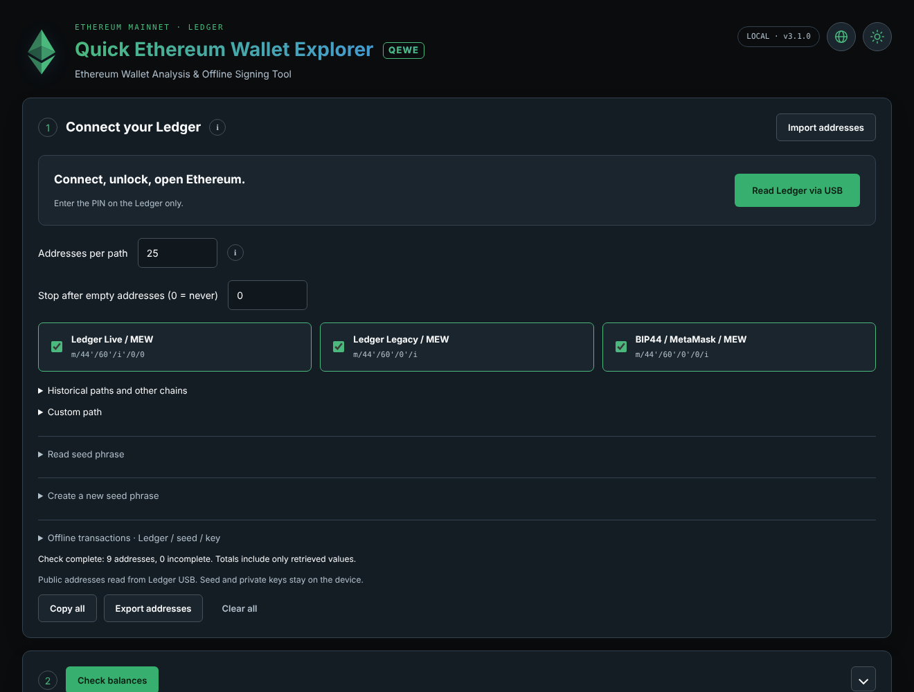
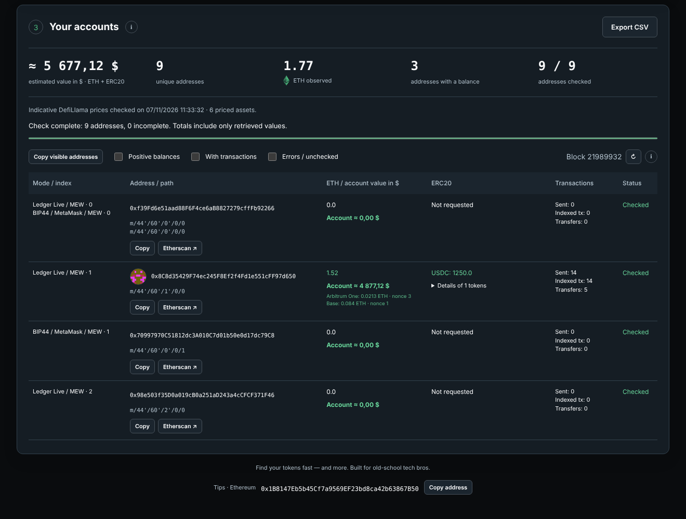

# QEWE — Quick Ethereum Wallet Explorer

**Ethereum Wallet Analysis & Offline Signing Tool**

Desktop utility (Windows 11 x64; Linux and macOS builds in preparation) that finds
forgotten Ethereum funds. Ledger USB comes first: read public addresses across
Ledger Live, Legacy, BIP44, historical MEW and custom paths, inspect ETH/ERC20
balances on Ethereum and native balances on major EVM networks, and prepare
explicit Ethereum mainnet transfers. Software phrase/key reading
and local BIP39 generation are secondary tools. Software signing is restricted
to the explicit offline transaction flow.

## Status

Version 3.1.0 is a security-hardening candidate, not an independently audited
wallet. Automated tests use published test wallets, mock Ethereum nodes and a
simulated Ledger. No physical Ledger or Windows 11 execution test has been
performed by the build environment. Do not describe this as certified or safe
for important funds. Start with public addresses and disposable test wallets.

## Why QEWE?

The same recovery phrase gives completely different addresses depending on the
derivation path a wallet used: Ledger Live, Ledger Legacy, MetaMask/Trezor
(BIP44), old MyEtherWallet options, Ethereum Classic paths... and the same
address can hold funds on Arbitrum, Base or Optimism that Ethereum explorers do
not show. QEWE checks all of these at once, from your Ledger without exposing
your seed, and tells you where your funds are.




## Main features

- **Trezor and BitBox02** (experimental): read public addresses from a Trezor
  Model T / Safe 3 / Safe 5 or a BitBox02. Ledger remains the main device and the
  only one used for signing.
- **Multi-network check** (opt-in): native balance and nonce of every address on
  Arbitrum One, Base, OP Mainnet, Polygon PoS, BNB Smart Chain and Gnosis, with
  default public RPCs or your own. Transactions remain Ethereum mainnet only.
- **Stop after N empty addresses** per path (gap limit), so you can ask for 1,000
  addresses per path and only check what matters.
- **Historical paths** offered by MyEtherWallet/MyCrypto: Ethereum Classic,
  Ledger Live ETC, Ledger ETC, testnet and RSK, for funds sent while the wrong
  path or network was selected.
- **Full token and NFT discovery** (opt-in) through Blockscout indexers. Results
  are display-only and unverified: airdropped spam tokens are common, never
  interact with an unknown token contract.

- 25 addresses per path initially, adjustable from 1 to 10,000; shared addresses
  retain their derivation associations. Tables show 250 rows per page.
- ETH plus 25 default ERC20 tokens; custom Ethereum token contracts supported.
- Indexed history, USD estimates and token/NFT discovery are on by default for an
  Ethereum-only check and switch off when extra networks are selected. Selected
  RPC providers see public addresses when a balance check is requested. Enabled
  history and price providers see the public data needed by those requests.
- 20 UI languages, English initially; some technical messages in additional
  languages fall back to English. Local fonts and translations, no translation API.
- Day/night mode, deterministic local Blockies, copy, Etherscan links and public
  JSON/CSV export. Never share exports containing private keys or phrases.
- Online transfers require a Ledger account read during the current session.
  Destination, amount and fees must be checked and confirmed on the device.
- Offline unsigned/signed JSON envelopes work with Ledger, standard BIP39,
  root xprv and a raw Ethereum private key. Signed exports can authorize a
  broadcast; keep them private until you intend to publish that transaction.

## Security boundaries

Never type a Ledger recovery phrase into this or any computer application.
Software secrets exist in computer memory and cannot be securely erased by
JavaScript guarantees. The application offline toggle blocks its network calls;
it does not disconnect the operating system. Physically disconnect the signing
computer for the offline software-signing workflow.

Only canonical Ethereum-mainnet EIP-1559 ETH transfers and supported ERC20
`transfer` calls are accepted. No arbitrary calldata, approvals, message signing
or EIP-712. Nonce, balances, simulation, signer and the exact reviewed bytes are
checked; ambiguous broadcast responses are not automatically retried.

Absolute signing limits: **0.05 ETH total fee cap**, **1000 Gwei max fee per gas**,
**50 Gwei max priority fee**, and **1,000,000 gas**. These are upper bounds, not
recommendations or cost estimates. Transfers exceeding them are refused online
and when importing an offline envelope. The recipient and transfer amount are
still the user's responsibility. RPC data can be false or unavailable.

The renderer is sandboxed and isolated; embedded scripts are local. HTTP bodies
are capped while streaming. The packaged Windows runtime disables Node-mode,
Node options and inspector switches, enables ASAR validation and only loads the
packaged ASAR. These controls do not protect against a fully compromised computer
or an attacker who can replace the unsigned executable itself.

See [SECURITY.md](SECURITY.md), [SECURITY_REVIEW.md](SECURITY_REVIEW.md) and
[AUDIT_SECURITE_2026-11.md](AUDIT_SECURITE_2026-11.md) (French).

**Download only from this repository's Releases page, and verify the file:**
see [docs/VERIFY.md](docs/VERIFY.md). Copies of wallet tools with stolen names
are a common way to steal recovery phrases.

## Run from source

Install Node.js **24.x** and use the committed lockfile:

```sh
npm ci --ignore-scripts
npm audit --audit-level=low
npm audit signatures
npm run build:vendor
npm run verify:vendor
npm test
npm run test:dom
```

Lifecycle scripts are disabled by `.npmrc`. For Electron execution, explicitly
install its official runtime after reviewing the dependency verification:

```sh
node node_modules/electron/install.js
node node_modules/esbuild/install.js
npm start
```

For the Linux headless integration tests, use `npm run test:native` and run
`tests/native-v22.cjs` / `tests/native-v23.cjs` through the Electron CLI. System
libraries needed by Electron must be available. No sandbox-disabling flag should
be added to make a test pass.

## Build

```sh
npm run build              # Windows NSIS installer
npm run verify:release     # or: verify:release -- linux / -- mac
npm run build:linux        # AppImage (x64)
npm run build:mac          # dmg (Apple Silicon, ad-hoc signed)
```

Tagged releases are built by `.github/workflows/release.yml` on all three
platforms with SHA256 sums and GitHub build-provenance attestations. See
[docs/RELEASING.md](docs/RELEASING.md) for code signing.

Linux note: Electron's sandbox needs unprivileged user namespaces. Some
distributions (Ubuntu 24.04+) restrict them for AppImages through AppArmor; do
not work around this with `--no-sandbox`. Use a distribution profile that allows
the AppImage, or build from source.

Output goes to `../deliverables`. The builder uses the pinned official Electron
runtime and NSIS tooling, which may be downloaded over HTTPS during building.
No certificate is included. The installer is per-user and provides desktop and
Start menu shortcuts. Existing application installation identity is preserved.
No executable is uploaded or published by these commands.

`VENDOR_SHA256.json` pins vendored bytes; rebuilding must reproduce them. Any
intentional update requires reviewing the upstream changes and updating this
manifest, not silently overwriting its checksums. Dependency versions, audit
results and release hashes are not permanent guarantees against compromise.

## Voluntary tips

Ethereum mainnet: `0x1B8147Eb5b45Cf7a9569EF23bd8ca42b63867B50`

The address is visible and copyable in the footer. QEWE never automatically sends
a donation, adds a hidden fee or requires payment. Ethereum transfers are public:
a donation address can link a pseudonym to earlier activity. Verify the address
against the intended project's release before sending.

## License and contributions

Original code is offered under the [MIT license](LICENSE); upstream licenses and
credits remain in [THIRD_PARTY_NOTICES.md](THIRD_PARTY_NOTICES.md). Forks may modify
the program, including its donation address. A mandatory immutable donation
address is not imposed by this MIT license. Please distinguish forks clearly.

Security reports: after publication, use GitHub private vulnerability reporting
if enabled by the repository maintainer. Never post real recovery phrases,
private keys, signed transactions or account credentials in issues.
