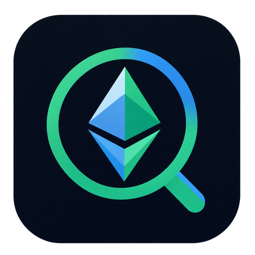
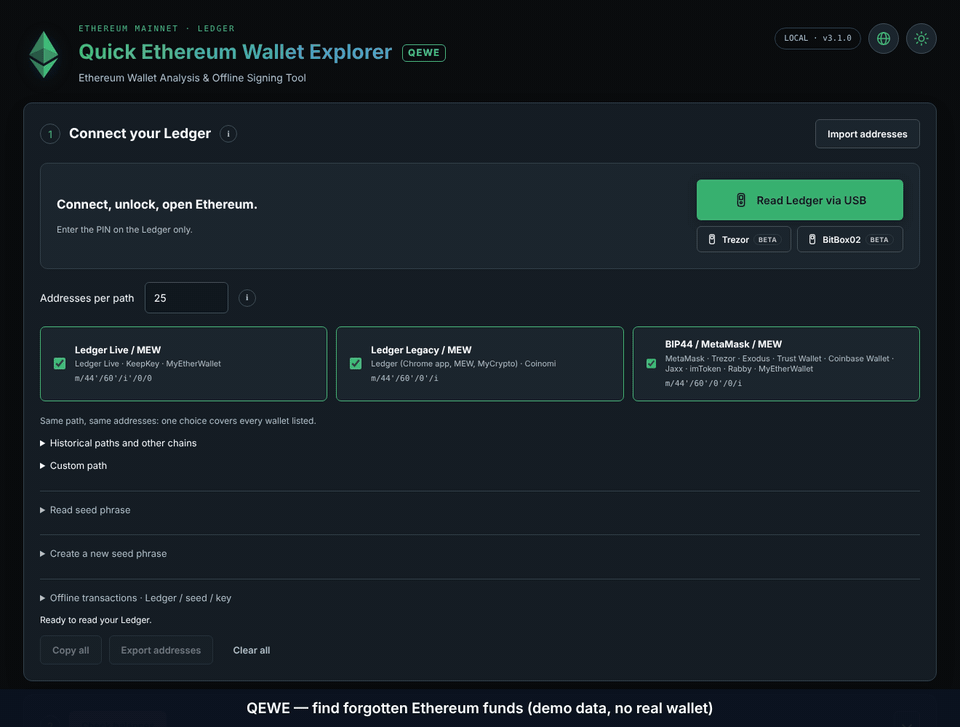

# QEWE · Quick Ethereum Wallet Explorer

**Ethereum Wallet Analysis & Offline Signing Tool**

Ledger-first address discovery, ETH/ERC20 balance checks and explicit offline signing.
Free, open source, MIT. **Experimental public preview: 3.2.0-rc.3. No independent security audit.**

[Download the preview](https://github.com/qeweproject/QEWE/releases/tag/v3.2.0-rc.3) · [Project website](https://qeweproject.github.io/QEWE/) · [Verify your download](docs/VERIFY.md) · [Security policy](SECURITY.md)

Never enter a Ledger recovery phrase into a computer application. Start with public addresses or a disposable test wallet.

## Downloads

| Platform | Package | Signing status |
| --- | --- | --- |
| Windows x64 | NSIS installer; Windows 11 recommended | No Authenticode publisher signature |
| Ubuntu/Debian amd64 | `.deb`, built on Ubuntu 24.04 | SHA256 and GitHub build provenance |
| macOS Apple Silicon | arm64 `.dmg` | Ad-hoc signed; no Apple notarization |
| macOS Intel | x64 `.dmg` | Ad-hoc signed; no Apple notarization |

The release workflow publishes only after all four native build and payload checks succeed. Release files include checksums, a source manifest, a dependency SBOM and a Sigstore provenance bundle. Attestations identify the build; they do **not** certify the code or replace operating-system publisher signatures. The build environment has not tested physical hardware wallets or every target OS version.

## See the interface



*20.8-second demonstration from an earlier preview layout. Wallets, balances and device interactions are simulated test fixtures; this is not a hardware test. Current downloads include the magnifying-glass logo and keep optional metadata services off initially.*


## What it does

- Reads public Ledger addresses across Ledger Live, Legacy, BIP44/MetaMask, historical MEW and custom paths. The PIN is entered on the device.
- Generates 25 addresses per path initially, configurable from 1 to 10,000. Duplicates retain their derivation associations; results are paginated. Imported/combined tables are capped at 40,000 rows.
- Checks ETH and 25 default Ethereum ERC20 contracts, with custom contracts and selections. Optional other EVM networks check native balances and nonces; transfers remain Ethereum mainnet only.
- Offers optional indexed activity, USD estimates and token/NFT discovery. **All three are off initially** and need native consent before first use. Discovery is incomplete and unverified; spam tokens are common.
- Keeps early stopping disabled initially. When enabled, unknown token/network/activity results are not treated as proof that an address is empty. No scan guarantees finding every historical wallet or token.
- Supports 20 interface languages, English initially, with local translations/fonts; day/night mode, local Blockies, public JSON/CSV exports and copyable addresses.
- Prepares ETH/ERC20 transfers from Ledger accounts read in the session. The exact recipient, asset, amount and fees must be checked and confirmed on the Ledger.
- Supports explicit offline signing with Ledger, standard BIP39, root xprv, raw private keys or supported encrypted JSON keystores. Software reading and new phrase generation are secondary tools.
- Includes **experimental, read-only** Trezor and BitBox02 integrations. They are not used for signing and have not been validated here on physical devices.

## Use it

1. Install the package for your architecture. Close an existing QEWE instance first. On Windows the installer recreates Desktop and Start-menu shortcuts with the QEWE icon.
2. Prefer a Ledger or an import containing only public addresses. Select paths and the range, then check balances.
3. Inspect incomplete/error states as well as positive balances. An outgoing nonce alone cannot detect every past incoming transfer.
4. For a transaction, review the full summary and confirm on the hardware screen. Never approve an unexpected prompt. Keep signed exports private until you intend that exact transfer to be broadcast.

For software signing, use a trusted computer **physically disconnected from the network**. The application offline toggle only blocks its own network calls. See [verification and offline guidance](docs/VERIFY.md).

## Privacy and remaining risks

The intended renderer/worker design uses a local-only CSP, a sandbox, context isolation and a file request filter. Main-process IPC validates the sender and public inputs. A new RPC URL requires native consent; optional price/indexer requests require a separate consent. Online RPCs and indexers see queried public addresses and can correlate them or provide false data. Explorer links share an address with the external site opened by your browser.

This is not a formal proof of secret isolation. A compromised dependency, renderer, unsigned executable or operating system can defeat application controls; a malicious renderer could encode private data into apparently valid public requests. JavaScript does not guarantee physical RAM erasure or deletion of another application's clipboard history. Prefer hardware and public-address imports for online use.

Only canonical Ethereum-mainnet EIP-1559 ETH transfers and supported ERC20 `transfer` calls are signed. No approvals, arbitrary contract calls, EIP-712 or message signing. Existing absolute fee/gas limits remain enforced; they are refusal ceilings, not recommended fees. Offline data, RPC simulations and future execution can disagree.

The legacy Ledger WebHID transport is deprecated upstream; migration requires separate protocol and physical-device testing. Review [SECURITY.md](SECURITY.md), [the internal review](REVIEW_3.2_RC1.md) and upstream notices before use. Automated checks and zero known audit findings are limited evidence, not an independent audit.

## Build and inspect

Use Node.js 24.x and the committed lockfile on a separate development computer:

```sh
npm ci --ignore-scripts
npm audit --audit-level=low
npm audit signatures
npm run build:vendor
npm run verify:vendor
npm run verify:privacy
npm test
npm run test:dom
```

For source execution, explicitly install the reviewed official tool runtimes with `node node_modules/electron/install.js` and `node node_modules/esbuild/install.js`, then `npm start`. Lifecycle scripts are disabled by `.npmrc`. Do not disable the Chromium sandbox to make the program start.

Build on the corresponding OS, then verify the resulting installed payload:

```sh
npm run build
node scripts/verify-release.cjs win x64
npm run build:linux
node scripts/verify-release.cjs linux x64
npm exec -- electron-builder --mac dmg --arm64 --publish never
node scripts/verify-release.cjs mac arm64
npm exec -- electron-builder --mac dmg --x64 --publish never
node scripts/verify-release.cjs mac x64
```

Full 7-Zip with NSIS support is required to inspect Windows installers. Builds go to `../deliverables`. The verifier compares embedded application bytes and runtime protections; it does not establish independent bit-for-bit installer reproducibility. See [release process](docs/RELEASING.md).

## Optional tips

Ethereum mainnet: **`0x1B8147Eb5b45Cf7a9569EF23bd8ca42b63867B50`**

No payment is required, no hidden fee is added and no donation is sent automatically. Verify this public address against the official project before sending. Blockchain transfers can link a donation address to other activity. Forks may change their own donation address under the MIT license.

## Contributing and reporting

Use [CONTRIBUTING.md](CONTRIBUTING.md). Report vulnerabilities privately through the repository's Security tab when private reporting is enabled. Do not put seeds, private keys, RPC credentials, signed personal envelopes or wallet-address exports in public issues. Contributions and reviews are welcome; no security certification or external audit is claimed.

MIT covers original QEWE code. Preserve all [upstream notices and licenses](THIRD_PARTY_NOTICES.md). QEWE is an independent project, not an official product of Ledger, Trezor, BitBox or the Ethereum Foundation.
